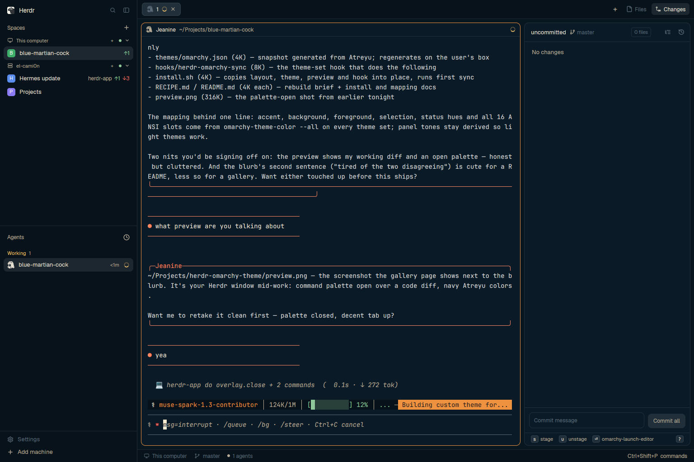

# herdr-omarchy-theme

A Herdr app theme that follows your Omarchy desktop theme. Switch Omarchy
themes and Herdr follows on the next `omarchy theme set` — background,
foreground, accent, status hues and all 16 ANSI slots regenerate from the
active Omarchy palette.



The snapshot in `themes/omarchy.json` was generated from the Atreyu Omarchy
theme. Yours will look like whatever Omarchy theme you run.

## Install

Requires Omarchy (for `omarchy-theme-color` and the `theme-set` hook) and
the Herdr app.

```sh
# Easiest: the installer copies the layout, theme, preview and hook
./install.sh
herdr-app do layout.switch --name omarchy

# By hand:
cp layouts/omarchy.json ~/.config/herdr-app/layouts/omarchy.json
cp themes/omarchy.json ~/.config/herdr-app/themes/omarchy.json

# 2. Install the sync hook (runs on every Omarchy theme switch)
omarchy hook install theme-set hooks/herdr-omarchy-sync

# 3. Generate from your current Omarchy theme and activate
~/.config/omarchy/hooks/theme-set.d/herdr-omarchy-sync
herdr-app do app.theme --name omarchy
```

From here on, every `omarchy theme set <name>` rewrites `omarchy.json` and
re-applies it, but only while `omarchy` is still your active Herdr theme —
switch to another Herdr theme and the hook leaves your window alone (the
file still regenerates underneath, so switching back picks up current
colors).

## How it maps

| Herdr | Omarchy |
|---|---|
| background / foreground / selection / cursor | same-named resolved keys |
| ansi 0–15 | `color0`–`color15` (base hues, then brights, as fallback) |
| accent / solid | `accent` |
| text on accent | dark ink on dark-mode themes, pale on light-mode ones (`mode` key) |
| working / blocked / done | yellow / red / green |
| idle / unknown, muted, dim | `muted`, `dark_foreground` |

Panel tones (`canvas`, `chrome`, `surface`, …) are deliberately unset so
Herdr derives them from `background` — that derivation already handles
light and dark appearances.

## Watch out

- Omarchy runs hook files through `bash`, ignoring shebangs — the hook is
  a bash wrapper around embedded Python for that reason.
- `themes/omarchy.json` is generated: hand-edits are overwritten on the
  next theme switch. Fork the mapping in the hook if you want custom tweaks
  to survive.
- The hook re-applies via `herdr-app do app.theme` only when `omarchy` is
  the active theme (checked in the shown layout's `.state`, its root, and
  `settings.json`).
