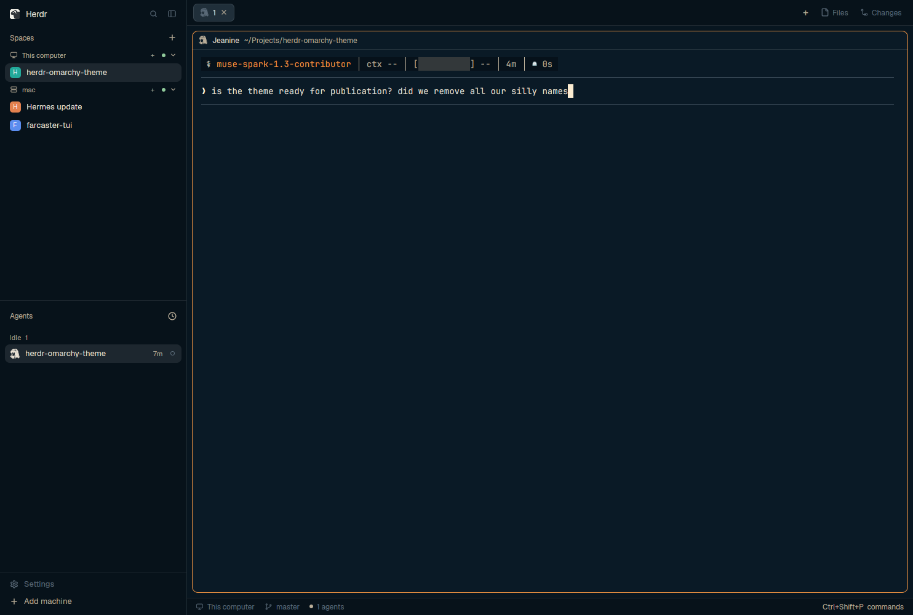

# Omarchy theme for Herdr

A Herdr app theme file plus a sync hook, so the Herdr window always wears
the active Omarchy desktop palette. Switching Omarchy themes updates the
Herdr window to match.

## What you see

The whole Herdr window in the Omarchy theme's colors: sidebar, agents list,
tab bar and pane headers derive panel tones from the theme's background;
the terminal panes use its foreground and all 16 ANSI slots; the accent
(gold on Atreyu) marks the focused pane, buttons and highlights; agent
status keeps its meaning — yellow working, red blocked, green done, muted
idle. Switch the Omarchy theme from light to dark and Herdr follows both
directions, including readable text on accent buttons.

## How it behaves

- `omarchy theme set <name>` rewrites `~/.config/herdr-app/themes/omarchy.json`
  and re-applies it in the open window within a second, with no restart.
- If the person switched Herdr to a different theme meanwhile, the window is
  left alone; the file still regenerates so switching back lands on current
  colors.
- Running the hook by hand with any argument (or none) does the same single
  sync. It exits 0 and silent on success.

## Built from

- `layouts/omarchy.json`: the default Herdr window shape — spaces + agents
  sidebar on the left (shipped `spaces` and `agents` mods), tab strip
  (`tabs`) over card-framed panes with the shipped `pane` header — with root
  `"theme": "omarchy"` and `"preview": "layouts/omarchy.png"`. No mod clones:
  everything structural is shipped, so it tracks app updates.
- `themes/omarchy.json`: `{ background, foreground, selection, cursor?,
  ansi: [16 colors], colors?: {...} }`, all `#rrggbb`. Panel colors omitted
  on purpose (Herdr derives them). A snapshot generated from Atreyu ships as
  the example.
- `hooks/herdr-omarchy-sync`: a bash script (Omarchy executes hooks with
  `bash`, shebang ignored) wrapping embedded Python 3 (stdlib only). It reads
  the resolved palette from `omarchy-theme-color --all` (staged theme under
  `~/.local/state/omarchy/current/theme`, never the raw colors.toml, so
  aliases and fallbacks match what the desktop uses), maps per the table in
  README.md, writes atomically (tmp + rename), then runs
  `herdr-app do app.theme --name omarchy` only if `omarchy` is the active
  Herdr theme — checked in `layouts/.state/<layout>.json` `theme` halves
  first (that is where the theme picker's choice lands), then the layout
  root, then `settings.json`.
- Install: theme file to `~/.config/herdr-app/themes/`,
  `omarchy hook install theme-set hooks/herdr-omarchy-sync`, one manual run,
  `herdr-app do app.theme --name omarchy`.

## Watch out

- `omarchy-theme-color` only resolves while an Omarchy theme is staged; on a
  non-Omarchy box the hook exits nonzero with the resolver's stderr.
- ANSI falls back to base hues when a theme ships no `colorN` slots, and to
  `#808080` / `#ffffff` if even those are missing — a theme that sparse will
  look flat but never break the JSON.
- Uppercase hex from some themes (e.g. `#205EA6`) passes through; Herdr
  accepts it.
- `herdr-app check` covers mods, not theme files: validation here is JSON
  parsing plus `herdr-app status` showing empty `errors`.
- The repo's `preview.png` is a real window shot (`herdr-app shot`), showing
  the clean window on Atreyu: sidebar, agents, and a single terminal pane.

## Done when

- [ ] Fresh `omarchy.json` from the hook parses as JSON with 16 ansi entries.
- [ ] `herdr-app status` reports `errors: []` after applying it.
- [ ] A screenshot shows sidebar, agents, tabs and a terminal in the Omarchy
      theme's colors with readable text throughout.
- [ ] Switching Omarchy themes (dark to dark, and dark to light) updates the
      Herdr window without touching any other setting.
- [ ] With a non-omarchy Herdr theme active, an Omarchy switch regenerates
      the file but leaves the window alone.
